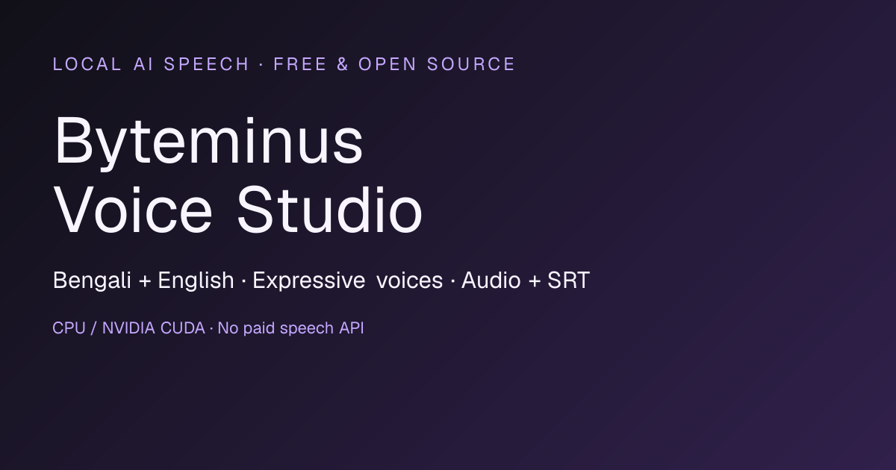

# ByteminusVoiceStudio — Bengali & English AI Text to Speech

> Hardware update: automatic CPU/CUDA/ROCm/XPU/MPS selection and experimental Windows DirectML. GPU tensor detection does not verify speech. **[Compatibility, tested limits and update commands](docs/HARDWARE.bn.md)**.

[](https://github.com/thanvi47/ByteminusVoiceStudio/actions/workflows/ci.yml)
[](LICENSE)
[](https://github.com/thanvi47/ByteminusVoiceStudio/stargazers)
[](https://github.com/thanvi47/ByteminusVoiceStudio/forks)
[](https://github.com/thanvi47/ByteminusVoiceStudio/releases)
[](https://github.com/thanvi47/ByteminusVoiceStudio/releases)

**[বাংলায় সম্পূর্ণ installation guide](docs/INSTALL.bn.md)** · [Hardware and models](docs/NEURAL.md) · [Contributing](CONTRIBUTING.md) · [SEO/deployment](docs/SEO.md)

**Setup by OS:** [Windows](docs/INSTALL.bn.md) · **[macOS / Linux / Ubuntu](docs/INSTALL.mac-linux.bn.md)**



Free, open source **local neural text-to-speech** for Bangla/Bengali and English. Next.js, TypeScript and Python inference with automatic CPU/NVIDIA CUDA selection. Generate WAV/MP3 voiceovers and estimated SRT subtitles; optional expressive models and private voice cloning. No paid speech APIs, subscriptions or cloud credits.

বাংলা ও ইংরেজি neural voice তৈরি করুন নিজের কম্পিউটারে।

**[Download a versioned source ZIP](https://github.com/thanvi47/ByteminusVoiceStudio/releases)** · [Repository clone/view statistics (owner access)](https://github.com/thanvi47/ByteminusVoiceStudio/graphs/traffic)

The live badges show GitHub stars, forks, package version, CI and release-asset downloads. Download counts are download events, not unique people or successful installations; they exclude `git clone` and GitHub's automatically generated source archives. Clone/unique-cloner/view statistics are available separately in owner-only Insights → Traffic. There is no in-app telemetry, remote install identifier or active-user tracker. Badge values can be cached by Shields/GitHub.

## Voices and delivery

| Engine | Profiles | Language | Controls |
| --- | --- | --- | --- |
| Mithi v2 Flash | 10 | Bengali | Natural neural speech; emotion effects disabled |
| Kokoro v1 | 28 | US/UK English | Natural neural speech; emotion effects disabled |
| Parler-TTS Mini v1 | 34 named speakers | English, speaker-dependent accent | Prompted delivery and optional voice direction; results vary |
| Indic Parler (optional gated download) | Arjun/Aditi | Bengali expressive | Model-directed emotion; own approved Hugging Face access required |
| eSpeak NG | 6 legacy configurations | Bengali/English | Robotic engine, only by explicit selection |

These are model speaker profiles, not 72 verified voice artists. Bengali regional accent is unverified. Parler directions are qualitative; exact emotion/intensity is not guaranteed. Failed neural requests **never silently fall back to eSpeak**.

## Windows setup

Install Node.js 22 and Git, open a new PowerShell, then:

```powershell
git clone https://github.com/thanvi47/ByteminusVoiceStudio.git
cd ByteminusVoiceStudio
./scripts/setup.ps1
npm run dev
```

**All optional features:** approve [Indic model access](https://huggingface.co/ai4bharat/indic-parler-tts) in your own HF account first, then use `./scripts/setup.ps1 -All`. It installs locked web/Python dependencies, all engines and reference transcription, prompts for local HF login when needed, and runs `npm run doctor -- --all`. Optional cloning weights have noncommercial/community terms. For feature flags, GPU setup, updates and recovery, follow the [complete step-by-step guide](docs/INSTALL.bn.md). Compatible drivers, storage, internet and upstream model permission are still needed; zero errors on every PC cannot be guaranteed.

**Bengali expressive voices (Arjun/Aditi) are a separate installation.** The commands above install ordinary Bengali Mithi voices and English expressive Parler, not the gated Indic model. On each new computer, sign into Hugging Face and accept the model's access conditions at [AI4Bharat Indic Parler](https://huggingface.co/ai4bharat/indic-parler-tts). Then, from the project folder:

```powershell
./.venv/Scripts/hf.exe auth login
./scripts/setup-bengali-expressive.ps1
```

Wait for the model and description tokenizer download to finish successfully, then stop the running studio terminals with Ctrl+C and run `npm run dev` again. Select Bengali · Expressive. For ordinary Bengali speech without this extra setup, select Bengali and a Mithi voice. Model files and login tokens are not included in the Git repository.

Open http://127.0.0.1:3000. Keep the terminal running. Setup installs isolated Python 3.12 environments and selects official CPU or CUDA 12.8 PyTorch wheels using NVIDIA driver detection. Override with `-Device cpu` or `-Device cuda`. A compatible NVIDIA driver is required for CUDA; no driver or paid service is installed. Omit `-Expressive` for just Mithi/Kokoro. Model weights, caches, environments and generated samples are ignored by Git.

After setup, `npm run dev` starts/reuses both services. Hardware is selected independently in the main and expressive environments. The editor supports 3,000 characters on CPU, 6,000 on usable accelerators below 16 GB VRAM, and 12,000 on larger accelerators. Long neural scripts render sequentially in hardware-sized batches and join into one recording and estimated SRT. First generation loads the chosen model; CPU Parler can take many minutes per section. See [NEURAL.md](docs/NEURAL.md).

Expressive CPU requests can exceed five minutes for a paragraph. The local audio connection uses an explicit deadline instead of fetch's independent header timeout; the worker allows up to 20 minutes. A timeout or dropped connection is reported separately from an offline server. Do not submit the same script again while generation is pending. The audio preview sits directly under Generate in the script column.

## macOS / Linux / Ubuntu setup

After installing Node.js 22+, Git and the native audio/build dependencies from the [Unix guide](docs/INSTALL.mac-linux.bn.md):

```bash
git clone https://github.com/thanvi47/ByteminusVoiceStudio.git
cd ByteminusVoiceStudio
bash scripts/setup.sh
npm run dev
```

Use `bash scripts/setup.sh --all` for all optional models after approving Indic access in your own HF account. macOS requires Apple Silicon for the pinned neural stack and probes MPS with CPU fallback. Linux supports CPU and compatible CUDA/ROCm/XPU setups. Intel macOS is not supported by the pinned modern PyTorch wheel. The Unix package workflow checks installation/imports without downloading models; it does not claim full neural-generation verification on those OSes.

## Features

- TXT import, language detection, character/word counts, pause tags, browser-local projects and session audio history.
- WAV/MP3 export, actual waveform/duration, browser playback volume/speed.
- Generate voice + SRT and both download actions sit directly below the script. SRT uses estimated sentence timing.
- Speaker play buttons use saved neutral MP3 samples, separate from script generation. Samples remain available after reload and without running the neural service.
- 23 delivery presets including Funny, intensity, speed/pitch and freeform Parler voice direction.
- Speaker ▶ buttons play fixed neutral samples. **Test current settings** generates the first sentence using the selected speaker, effect, speed and pitch. Generated recordings display their actual settings, and changing any setting marks the existing recording as outdated.
- Jon, Lea, Arjun and Aditi have saved **Excited / Scared** examples in Playground; these play immediately using fixed generic scripts and do not synthesize your current script. Female demo choices explicitly select Lea (English) or Aditi (Bengali). Their `✓ TESTED` mark means both emotion requests produced audio in local checks, not a guarantee of acting quality for every script.
- For English **Excited** and **Scared / Scary**, use the Parler expressive engine. Choosing either emotion replaces conflicting previous delivery directions and resets manual speed/pitch to 1.00, so the model performs the style without automatic DSP. Playground → **Try an example…** includes both English demos and selects Jon with matching directions. Scared requests frightened, hushed delivery; this is model guidance, not a guaranteed horror voice or added echo/reverb.
- Bengali **Excited / Scared** examples select Indic Parler's Arjun and match the model's Happy/Surprise and Fear descriptions. Install the optional gated Indic model first; the examples cannot generate using Mithi. An accepted Hugging Face browser login does not automatically authenticate the command-line downloader. Keep all downloaded weights/configuration in `.models/indic/` and the matching FLAN-T5 description tokenizer in `.models/indic-description/`; none are committed.
- Voice library with search, language, gender and engine filters.
- Every voice picker includes a suggested delivery and short usage note (for example Jon · Excited, Emily/Emma · Calm). Optional automatic delivery selection applies the suggested preset when choosing a voice. These are app-curated suggestions, not verified traits or fixed emotions of real voice artists. Mithi/Kokoro emotion effects are disabled: automatic pitch shifting and time stretching caused unnatural, metallic speech. Only expressive engines use emotion prompts. Manual speed/pitch remain available; keep both at 1.00 for unprocessed speech.
- Quiet generated speech is automatically raised in level by default, with smooth peak limiting. **Output volume (0–300%)** is baked into the next WAV/MP3 export, including cloned speech. **Playback volume (0–300%)** changes the current player immediately and does not alter the download. Above 100%, supported browsers use Web Audio gain/compression. Automatic loudness can be disabled; it uses speech RMS, not calibrated LUFS. High boosts may sound compressed. Saved neutral previews are level-corrected too.
- Optional private voice cloning in Bengali and English: MP3/WAV import, 3–10 second reference selection, saved voice profiles and audio/estimated SRT downloads.
- Explicit PCM silence via `[pause 500ms]` and `[break 1.5s]`, at most 10 seconds per break.
- Estimated sentence-level SRT; dialogue beta with per-speaker assignment and separate line clips.
- Production shared-password login, signed HttpOnly cookies, validation and bounded generation.
- **Voice playground**: English/Bengali voice cards, neutral samples, random voice selection, 12 original vibes, six editable direction fields, example scripts, WAV/MP3 and estimated SRT, local saved presets, recipe JSON import/export, and Python/JavaScript/cURL examples for the local API. The latest two generated takes can be compared side by side. Vibe changes keep the user's script.

The playground is inspired by the interaction concepts of [OpenAI.fm](https://openai.fm/); its implementation and preset text are original. It uses the existing local engines. OpenAI voices (including Marin/Cedar), model weights and hosted demo endpoints are not included. The GPT-4o mini TTS API requires paid usage; no OpenAI API key or paid service is added. Qualitative directions only apply to expressive local engines; choosing a vibe does not guarantee OpenAI-level acting. Samples are neutral, and generation finishes before playback rather than streaming. Share uses a recipe file so no hosted database is required. Recipes contain the script and direction; share only what you intend to disclose.

## Production and limitations

Set `APP_ACCESS_PASSWORD` and a random `SESSION_SECRET` of at least 32 characters in `.env.local` or the environment. Never commit or paste credentials into chat. Production fails closed without both.

```powershell
npm run build
npm run start:studio
```

Use a trusted HTTPS reverse proxy for production secure cookies. Python must stay on loopback port 8123. Development without a password is allowed only outside production. See [deployment](docs/DEPLOYMENT.md).

Neural mode targets a local/self-hosted computer, not an ordinary Vercel function. Free software does not include free hosting, electricity, hardware or bandwidth. Neural script limits depend on the detected runtime, with at most 30 breaks and 10 minutes joined output on CPU or 30 minutes on an accelerator. Legacy synthesis keeps its 3,000-character/90-second limits; voice cloning keeps its separate 600-character/90-second limits. No merged dialogue or exact word alignment. Projects live in the browser; download generated audio before reload. Voices may mispronounce names or omit words; review before publishing.

## Optional voice cloning

Run `./scripts/setup-cloning.ps1`, then open **Voice cloning** in the sidebar. Upload your own/consented MP3 or WAV (up to 20 MB, 3–120 seconds). From a 30-second recording, choose a clean 3–10 second section. Confirm permission, choose the recording language and press **Auto transcribe selected audio**, or type its exact words manually. Optional transcription requires `./scripts/setup-transcription.ps1` once (free multilingual Whisper small, CPU int8). Recognition is a draft, especially for Bengali; listen and correct errors before saving. Visible validation explains missing fields; saving selects the new voice and focuses **Your script**. Enter the new words there, select Bengali or English and press **Generate cloned voice + SRT**. For best pronunciation, use a reference in the output language; cross-language cloning may carry the reference accent. Similarity is not guaranteed.

Profiles and transcripts persist privately in ignored `.data/voices/`, outside `public/`; delete them in the panel. They are shared by users of this single-owner studio password, not isolated accounts. Never deploy this as a multi-user service without separate storage and authorization. Generated audio is session-only. Upload decoding/resampling happens in the browser; only the selected mono WAV is sent to the local server. Optional transcription runs offline in a separate worker, keeps the clip in memory and releases the model after each request. There is no paid API. CPU inference may take several minutes.

OmniVoice **code** is Apache-2.0, but its downloaded **model weights are CC-BY-NC**, and its bundled audio tokenizer has the Boson Higgs Audio 2 Community License. This optional engine is free for noncommercial use; its weights are not unrestricted open-source assets. The main Mithi/Kokoro/Parler engines remain Apache-2.0. Do not assume commercial rights for cloning; see [third-party notices](THIRD_PARTY_NOTICES.md).

Generic speaker previews are committed in `public/voice-previews/v1/` and play without inference. To rebuild them after installing all three base engines, run `npm run previews:build`. The resumable builder only uses fixed public sample sentences, never private scripts or clone references.

## Bengali expressive speech (optional, model access required)

Mithi/Kokoro cannot perform emotional acting; automatic emotion effects are disabled. For Bengali model-directed emotion, this app includes an optional Indic Parler adapter with recommended Arjun/Aditi profiles. Create a free Hugging Face account and accept the upstream gate at [Indic Parler](https://huggingface.co/ai4bharat/indic-parler-tts). Then sign in locally with `.venv/Scripts/hf.exe auth login` and run `./scripts/setup-bengali-expressive.ps1`. Never paste your token into chat or commit it. Restart the studio and select **Bengali · Expressive**. No paid API or subscription is needed.

The model and its separate FLAN-T5 description tokenizer are pinned. The description tokenizer must match the model's 32,128-entry text encoder vocabulary; mT5 is incompatible. The adapter loads the complete Bengali tokenizer JSON directly and checks description vocabulary compatibility. It remains disabled without the required model/tokenizer files. Descriptive emotions are qualitative; exact acting is not guaranteed. English expressive Parler is already available with the existing setup. Arjun/Aditi have committed Excited/Scared samples made from fixed generic text; script generation still needs the installed model.

## Tests and contributions

```powershell
npm test
npm run typecheck
npm run build
./.venv/Scripts/python.exe -m unittest neural.test_server
```

Read [CONTRIBUTING.md](CONTRIBUTING.md), [testing](docs/TESTING.md), [API](docs/API.md) and [architecture](docs/ARCHITECTURE.md). Paid providers must not become required dependencies.

```text
app/       Studio UI and authenticated API
lib/       Validation, shared voice catalog, audio export and adapters
neural/    CPU/GPU probing, isolated expressive/DirectML workers and Python locks
scripts/   Setup, pinned model download and service startup
tests/     TypeScript tests and reusable browser specs
docs/      Setup, capabilities and deployment
```

## License

App: GPL-3.0-or-later. Mithi/Kokoro/Parler: upstream Apache-2.0 releases. Optional cloning weights have separate noncommercial/community terms described above; preserve all upstream notices. See [LICENSE](LICENSE) and [THIRD_PARTY_NOTICES.md](THIRD_PARTY_NOTICES.md). Model source revisions are fixed by the downloader. Some neural frontends use eSpeak for phoneme conversion; the audio decoder remains neural.
